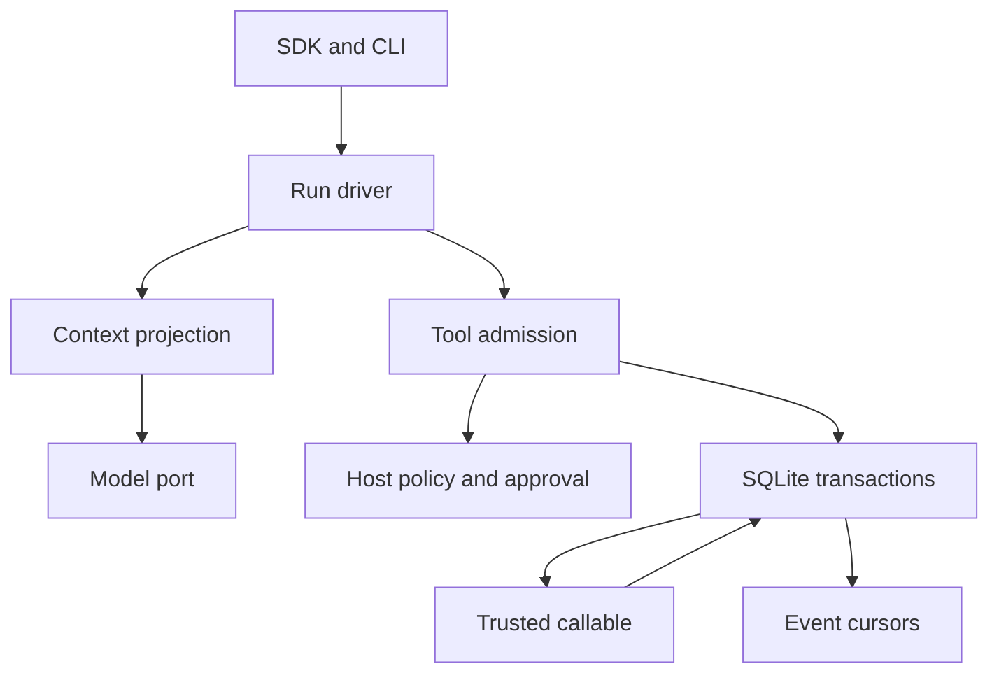

# Architecture

The journal records what execution knows. The model sees a bounded projection.
The host registers capabilities; a model cannot add capabilities by naming them.
Each batch is saved before its first call, and each saved outcome advances the
batch cursor. Recovery can distinguish undispatched calls from ambiguous I/O.
See [specification](specification.md) for the transaction and state contract.
